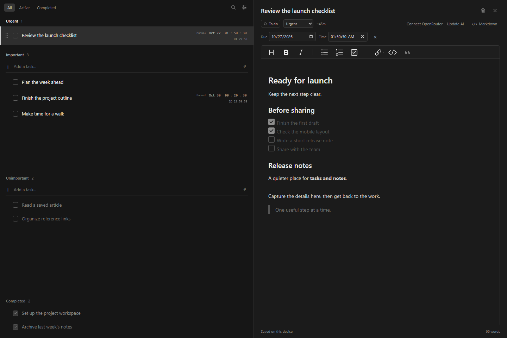
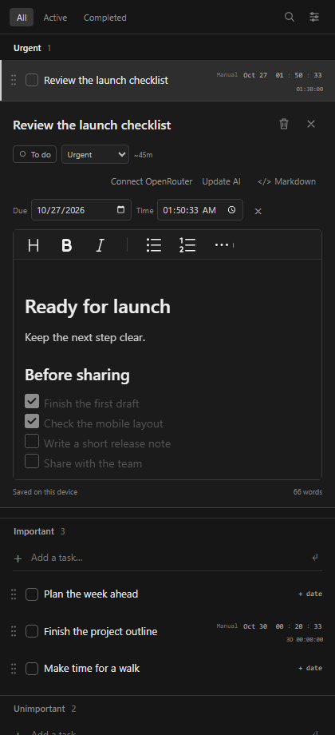

# Open Todo Zero

A minimal dark task list with editable Markdown notes. Fast to open, quiet to use, and useful without an AI account.





*Screenshots use sample tasks, notes, and manually set deadlines.*

## Run locally

Requires Node.js 20 or newer. Browser dependencies are included; no install step is needed.

```sh
git clone https://github.com/thencious/open-todo-zero.git
cd open-todo-zero
npm start
```

Open **http://127.0.0.1:5173**. Tasks and notes are saved in that browser. To change the port, set the `PORT` environment variable.

## What it does

- **Tasks:** Important, Unimportant, and a hidden-until-needed Urgent section. Completed tasks move below everything else, newest completion first.
- **Notes:** Click a task to edit its title and open rich Markdown notes. Desktop uses a right pane; mobile expands inline. Raw Markdown is one toggle away.
- **Reordering:** Drag the whole row, or press Up / Down while a task is selected outside the notes editor.
- **Editing:** Enter confirms a new or edited title. Switching windows preserves the draft. Delete removes a selected task; Ctrl+Z / Cmd+Z restores it.
- **Deadlines:** Edit date, hour, minute, and second separately. Countdowns use `nD hh:mm:ss` and follow the system clock.

## Optional AI

Connect your own OpenRouter account in settings. Requests use **Nemotron 3.5 Super VL (free), followed by Nemotron 3 Ultra (free) on failure, with a $0 input/output price ceiling**, required function calling, and no paid fallback. Your account's free-model quota applies.

One request extracts a deadline and estimates work time. It runs only when you confirm a new task, confirm a changed title, or click **Update AI**. There is no local deadline detector. Failed calls show an error and retain response details for diagnosis.

Each request includes current UTC and sender-local time, timezone, UTC offset, and a date-to-weekday calendar table. Wording matters: "by tomorrow" means the end of the target day; an unspecified event time defaults to noon. From midnight through 04:59, "tomorrow" / "tmr" / "tmrw" means the same calendar day. Explicit dates and times take precedence.

Tasks become urgent when time remaining is at most **12 hours + estimated work time**. Alerts trigger when time remaining reaches the estimate.

## Optional reminders and server

Set **your own ntfy topic** in settings; none is configured by default. Browser notifications require permission and an open app. Already scheduled ntfy alerts can arrive after the app closes; the browser-only version needs reopening to queue deadlines farther than ntfy's scheduling window.

An optional private Worker + D1 backend stores task snapshots and AI diagnostics and schedules reminders independently of the browser. It requires authenticated hosting and an hourly scheduler; see [server setup](docs/server.md). Server backup is disabled in the default local/static app.

## Privacy and development

Notes stay in browser storage unless the optional backend is enabled. Connecting OpenRouter stores its key on that device; an AI request sends the task title and notes to OpenRouter. Disconnect removes the key. ntfy receives the task title and reminder details when enabled.

- UI source: [`dist/`](dist/)
- Optional backend: [`worker/api.js`](worker/api.js), [`drizzle/`](drizzle/)
- Recreate screenshots: `npm run screenshots` (Node.js 22+ and Chrome/Chromium required; override its path with `CHROME_BIN`)
- Build the optional Worker: `npm run build`

[MIT license](LICENSE). Bundled editor and sanitizer licenses are listed in [third-party notices](THIRD_PARTY_NOTICES.md).

Model selection is a curated priority order, not the random free router. Both listed endpoints advertise tools and tool_choice. The order uses general reasoning evidence and mandatory tool compatibility; it is not a task-specific accuracy ranking. No smaller/random model is silently substituted. The model actually used is recorded with each response.
